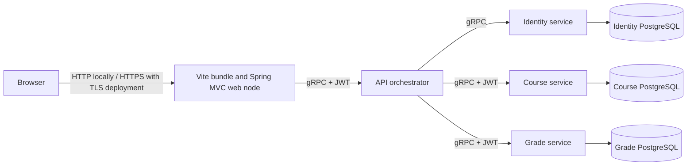

# Architecture and behavior

## Decision

The portal uses a standalone web node, a thin gRPC orchestrator, and three Spring Boot domain services. Course browsing and enrollment share one domain and database so checking capacity and allocating a seat are one local transaction.

AnimoRoll renders its views in the browser using plain HTML, CSS, and JavaScript built by Vite. The Spring MVC web node serves that bundle alongside same-origin browser endpoints under `/api`. This keeps one browser-facing node and one HTTP session boundary. Using Vite for assets while keeping server-rendered HTML would leave view logic in Spring. Hosting the Vite bundle independently would add cross-origin session configuration.

The browser sends form data and reads JSON over HTTP. The MVC controller handles sessions and CSV preview, then calls the orchestrator through its gRPC client. Domain controllers handle transport, and domain services own rules and transactions. The gRPC contracts are shared protobuf libraries.

## Ownership and seeded records

Identity owns users and login sessions. Courses owns current-semester offerings and enrollments. Grades owns teaching assignments, authoritative class rosters, and published grade records. Student identity comes from validated tokens; students cannot choose another student's ID in a grade-history or enrollment query. Faculty must own the course/term teaching assignment before reading its roster or uploading grades.

The included catalog and grade rosters are synthetic demonstration fixtures. Historical and current grade rosters are preloaded independently of enrollment. Enrolling in a current course does not automatically create a grade-service roster entry. In a wider registrar system, finalized rosters would be imported or synchronized through an explicit contract; that extra workflow is outside the five required features. The example current roster contains Alex and Sam so faculty upload can be demonstrated immediately. Published current-semester grades appear alongside historical results.

## Authentication and sessions

The identity service verifies BCrypt password hashes and signs RS256 JWTs. Every backend node independently validates the signature, issuer, audience, and expiration, and business services enforce roles and object ownership. The orchestrator forwards the original token, rather than substituting a user ID supplied by a caller.

JWTs carry `sub`, `name`, `role`, and `sid`. Access lifetime is 15 minutes. Refresh tokens are random, stored as SHA-256 hashes in PostgreSQL, rotated under a row lock, and valid for eight hours from login. The MVC node retains the token pair in a server-side HTTP session and attempts refresh after 14 minutes. The browser receives an HttpOnly, SameSite=Lax session cookie. A successful login creates a fresh browser session and clears any old preview. The frontend reads the CSRF token from `/api/session` and sends it with state-changing requests. Spring Security validates that token.

Logout revokes the persistent refresh session and clears the browser session. Already issued access JWTs remain verifiable until expiry; immediate global revocation would require an online check and introduce an identity dependency for every call. If identity is unavailable during logout, the browser session still clears and the login page explicitly reports pending revocation. Existing signed-in sessions keep accessing other services until refresh is needed. There is no cross-node in-memory identity lookup.

The view node uses local HTTP session storage and is not replicated. Multiple view replicas would require shared sessions or a revised browser authentication design. Domain nodes can validate the same JWT independently; shared browser-session failover is not claimed.

## Failure behavior

| Failed component | Expected effect | Still available |
| --- | --- | --- |
| Identity service or DB | New login, refresh, and persistent logout revocation fail | Courses and grades with a still-valid token |
| Course service or DB | Catalog and enrollment unavailable | Login and grades |
| Grade service or DB | Grade history, roster, grade upload unavailable | Login, catalog, enrollment |
| Orchestrator | All backend requests unavailable | Web shell, sign-in form, browser logout |
| Web node | Browser portal unavailable | Internal services remain running |
| One Docker host containing everything | Entire deployment unavailable | Requires separate hosts to isolate machine failures |

The frontend loads course and grade panels independently. An unavailable panel offers a retry for its own request. The shell and unaffected panels continue rendering, and counts appear when their underlying data has loaded.

Web-to-orchestrator calls have a three-second deadline, and orchestrator-to-domain calls have a two-second deadline. Cancellation/deadlines propagate through the Java gRPC context. There are no automatic write retries. Enrollment is idempotent for the student/course pair; repeated grade publishing sets the same values. A client timeout can leave a write's outcome unknown: inspect the enrollment receipt list or refreshed roster before retrying. PostgreSQL connection and socket timeouts bound persistence failures separately.

## Data integrity

Enrollment locks the owning course row with `FOR UPDATE`, checks capacity, and inserts within one transaction. Every replica uses the same lock. A composite primary key prevents duplicate student/course enrollment; duplicate requests return the existing-enrollment outcome. Closed/full/missing offerings are rejected by the backend.

Grade uploads check assignment ownership and every value. The confirm and discard actions refer to the exact preview shown in the browser. Each upload is capped at 500 records and updates existing roster entries in one transaction. An unknown student rolls back earlier rows. The service updates students in a consistent order so overlapping uploads acquire locks in the same order. The last committed value for a student is authoritative.

Each service uses its own PostgreSQL database, credentials, Hikari connection pool (maximum eight connections), and Flyway migrations. Database volumes preserve state across container recreation. There is no cross-service SQL or distributed transaction. This version uses a single current offering per course code; multiyear catalog administration and schedule/prerequisite rules are outside scope.

## Visual direction

Audience: students choosing courses and faculty publishing grades. The primary task remains in the content workspace with next actions beside the affected course or upload.

Three compositions were considered: dense registrar tables, a sidebar workspace with focused course cards, and a full-width editorial layout. The sidebar workspace was selected for clear destinations, readable schedules, and straightforward mobile adaptation. Dense tables remain appropriate for grade records; the editorial layout would displace the work. No external visual-reference inspection was completed; this direction is locally designed and does not claim fidelity to a reference application.

Tokens: slate text, navy welcome surface, teal primary actions, mint confirmations, white content on a quiet gray canvas, and restrained 7–12 px corners. Available system fonts are Segoe UI/Arial with an Inter fallback if locally installed. Page titles are 26–32 px, compact labels 10–12 px, and course titles 17–20 px. Narrow screens move navigation above content and stack cards. Tables retain horizontal scrolling in their own container. Errors retain their context and forms use semantic labels and visible focus.

## Boundaries to revisit

Reconsider service splitting if catalog browsing needs availability independent of enrollment. Add orchestrator/view replicas and shared browser sessions if those node failures must be tolerated. Add database replication with tested failover if the persistence bonus becomes required. Add authenticated TLS transport before running across untrusted networks.
